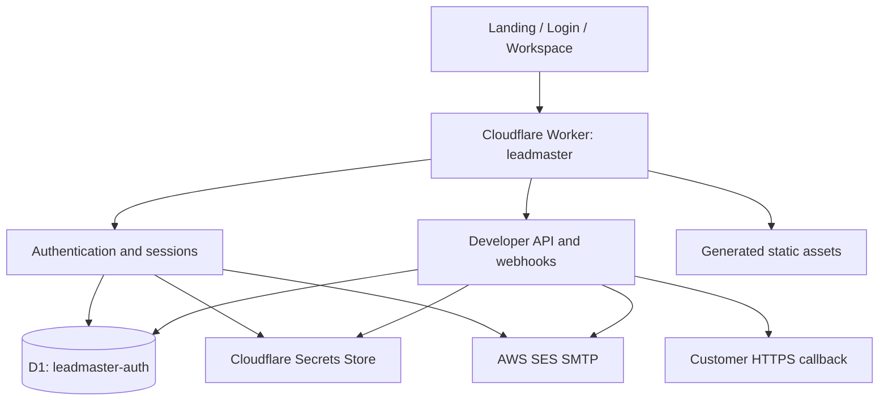

# LeadMASTER — Engineering & Production Handover

**Repository:** `DevJel/LeadMASTER` · **Branch:** `main`  
**Production:** https://leadmaster.jelvan.pro  
**Cloudflare Worker:** `leadmaster` · **Entry:** `worker.js`

## 1. Purpose and current product state
This is the root handover for maintainers, developers and agents. Update it whenever UI, API, backend, data, infrastructure or release behavior changes.

LeadMASTER is a Cloudflare Worker application with a static browser UI, D1-backed administrator authentication and developer API records, Secrets Store-backed credentials, and AWS SES SMTP transport. The dashboard remains a navigation shell. Campaigns, audiences, persistent template management, analytics and the production Queue/Durable Object send pipeline are incomplete. Authenticated SES and webhook callback acceptance tests remain outstanding.

## 2. Architecture



| Component | Binding / name | Purpose |
|---|---|---|
| Worker | `leadmaster` | Routing, auth, API, webhooks and static assets |
| D1 | `AUTH_DB` → `leadmaster-auth` | OTP challenges, sessions, rate limits, API keys, email requests, webhooks and delivery logs |
| Turnstile public key | `TURNSTILE_SITE_KEY` | Browser widget configuration |
| Turnstile secret | `TURNSTILE_SECRET` → `TURNSTILE_SECRET_KEY` | Server-side Siteverify |
| Session/OTP secret | `SESSION_SECRET` → legacy entry `ADMIN_JWT_TOKEN` | OTP HMAC and webhook-secret encryption |
| SES SMTP | `SES_SMTP_HOST`, `SES_SMTP_USERNAME`, `SES_SMTP_PASSWORD` | SMTP transport |
| Sender | `SES_FROM_EMAIL` | Configured sender identity |

Secret values must never appear in this file. The `SESSION_SECRET` binding's backing entry name is historical; it does not mean JWT sessions are used.

## 3. Authentication flow
1. `GET /api/auth/config` returns the public Turnstile site key.
2. Browser renders Turnstile with action `login`.
3. `POST /api/auth/login` checks same-origin, IP/email rate limits, Siteverify success, hostname `leadmaster.jelvan.pro`, action `login`, admin allowlist and password.
4. Password success creates a six-digit OTP, stores an HMAC hash in D1 and sends it through SES SMTP.
5. OTP expires in 10 minutes and is limited to five verification attempts.
6. Successful verification consumes the OTP and creates a random 32-byte opaque session token.
7. Only the SHA-256 token hash is stored in D1. Cookie: Secure, HttpOnly, SameSite=Strict; eight-hour lifetime.
8. Session lookup checks expiry/revocation. Logout revokes the record and clears the cookie.

**Caveats:** PBKDF2 hashes are supported, but legacy secret-value passwords are still accepted. Sessions are opaque D1-backed tokens, not JWTs. The source contains an unused challenge-cookie helper; current login relies on the login Turnstile widget and Siteverify. Do not rotate `SESSION_SECRET` without a migration/re-encryption plan for webhook secrets.

## 4. HTTP route map

| Method | Route | Access / purpose |
|---|---|---|
| GET | `/api/auth/config` | Public Turnstile config |
| POST | `/api/auth/login` | Turnstile + admin password; sends OTP |
| POST | `/api/auth/verify` | OTP verification; creates session |
| GET | `/api/auth/session` | Current session state |
| POST | `/api/auth/logout` | Revoke current session |
| GET / POST | `/api/developer/keys` | Admin-session protected list/create |
| DELETE | `/api/developer/keys/{id}` | Revoke API key |
| POST | `/api/v1/emails` | `email:send`; SES submission |
| GET | `/api/v1/emails/{id}` | Same-key `email:read` status |
| GET / POST | `/api/v1/webhooks` | `webhook:manage`; list/create |
| DELETE | `/api/v1/webhooks/{id}` | Revoke webhook |
| GET | `/api/v1/webhooks/{id}/deliveries` | Latest 50 attempts |
| GET | `/dashboard` | Redirect based on session |
| GET | `/dashboard.html` | Protected dashboard shell |
| GET | `/developer-api-keys.html` | Protected API-key/webhook console |

API keys are random `lm_live_…` values, shown once and stored as SHA-256 hashes. Scopes: `email:send`, `email:read`, `webhook:manage`.

## 5. Email API
- One recipient; required `to`, `subject`, `text`; optional `html`.
- Requires JSON, Bearer API key and stable `Idempotency-Key`.
- Current per-key rate limit: 30 requests/minute.
- Request records are scoped to their creating key.
- Statuses: `sending`, `accepted`, `failed`, `unknown`.
- `accepted` is SES SMTP acceptance, not inbox-delivery proof.
- `unknown` means acceptance may be uncertain; reconcile before retrying.
- Sender is configured server-side.

Not in contract: attachments, CC/BCC, multiple recipients, custom sender, campaigns, scheduling, saved templates or bounce/complaint/open/click analytics.

## 6. Webhooks
- Events: `email.accepted`, `email.failed`, `email.unknown`.
- Signing secret shown once and encrypted at rest using a key derived from `SESSION_SECRET`.
- Headers: `LeadMASTER-Id`, `LeadMASTER-Timestamp`, `LeadMASTER-Signature: v1=<hex>`.
- HMAC-SHA256 input: exact timestamp + period + raw body.
- One synchronous attempt per event, seven-second timeout, redirects disabled; latest 50 attempts logged.
- No automatic retry, replay, dead-letter recovery or delivery guarantee.
- URL checks do not pin DNS and do not fully prevent DNS rebinding. Only register callback hosts controlled by the integration owner.
- Payload includes recipient and subject; treat webhook records as sensitive.

## 7. Landing page and documentation
- Canonical UI source: `public/`.
- Production Worker serves generated `src/static-assets.mjs`; root `/` and `/index.html` should serve `public/index.html`.
- Public docs live inside the landing page Documentation tab.
- `/docs.html` and `/mcp.html` are legacy redirects into landing-page documentation anchors.
- Engineering source docs remain under `docs/` and must match the landing page and README.
- Run `npm run build:assets` after any bundled public asset changes.
- Unknown paths may fall through to the configured upstream preview Worker. The canonical landing page must remain bundled locally.

## 8. Experimental and incomplete areas
**Queue/Durable Object:** source modules exist, but no production queue/DO binding or active queue pipeline. Developer email API currently calls SES SMTP directly and records results in D1. Do not advertise proposed quota coordination or queue recovery as live.

**MCP:** read-only source prototype, not mounted in production. No public MCP endpoint, OAuth registration or email-send tool.

**Workspace:** dashboard is a shell. Mailbox, campaigns, audiences, saved templates, analytics and related backends are incomplete.

## 9. Local development and tests
```bash
npm ci --ignore-scripts
npm run build:assets
npm test
```
Tests use local/mock boundaries. They do not prove live Turnstile, OTP receipt, browser login, SES inbox delivery, webhook callback receipt or quota behavior.

## 10. Production release checklist
1. Confirm repository `DevJel/LeadMASTER`, branch `main`, Cloudflare account and Worker.
2. Inspect `wrangler.jsonc`, bindings, Secrets Store references and D1 migrations.
3. Update canonical `public/` files.
4. Run `npm run build:assets`; inspect asset paths/MIME types.
5. Run `npm ci --ignore-scripts` and `npm test`.
6. Review complete diff and `git diff --check`.
7. Deploy with `npx wrangler deploy` from the verified repository/account.
8. Verify `/`, `/index.html`, `/#documentation`, legacy redirects, `/api/auth/config`, unauthenticated protection, API method/auth behavior and active Worker version.
9. Record exact deployment/version, checks and blockers in this file and `CHANGELOG.md`.

### Controlled acceptance tests still required
- Browser Turnstile + password + OTP + dashboard + logout.
- OTP delivery to the authorized mailbox.
- API key create/revoke and scope enforcement.
- Controlled SES API send to an approved mailbox; distinguish SMTP acceptance from inbox receipt.
- Webhook registration, callback HMAC validation, delivery history and negative/replay tests.

### Rollback
Use Cloudflare Worker versions/deployments to route traffic to the last known-good version. Verify the selected version and traffic percentage, then repeat route and landing smoke checks. Do not delete D1, rotate secrets or revert schema migrations as a first-line rollback.

## 11. Latest deployment record — 2026-11-09
- Cloudflare Worker version: **113**.
- Version ID: `74522785-4f5f-43be-bd53-c70c4d8092bf`.
- Deployment ID: `8a552314-390a-42e2-b5be-89105ef86c69`.
- Traffic assignment reported by Cloudflare: **100%** to version 113.
- Cloudflare bundle inspection confirmed the root-to-`/index.html` mapping, integrated documentation markup, production status copy, documentation search logic, and compatibility redirect assets are present in the uploaded Worker bundle.
- Automated `npm test` was **not run** in this execution environment. No real browser sign-in, SES inbox delivery or webhook callback acceptance test was performed.

## 12. Handover status
Authentication, API-key, email and webhook route implementations are deployed. Landing-page documentation is the canonical public destination. Queue and MCP remain experimental/not deployed. Dashboard remains a shell. Real authenticated browser, SES inbox and webhook callback acceptance tests remain outstanding.


## 12. AI-agent and public-documentation handover
- Public machine-readable guide: `/llms.txt`; crawler policy: `/robots.txt`. Both are served from the same production asset bundle as the landing page.
- The landing page Documentation tab links to the AI-agent guide and contains copy-ready REST API instructions. Agent docs must never expose the human sign-in challenge, challenge tokens, public site key or internal provider details.
- Agent authentication is a server-to-server LeadMASTER API key with the minimum required scope. Do not automate human administrator login or request an OTP/challenge from the user.
- MCP is not deployed. `/mcp` returns an explicit 404 with guidance to use the REST API. Do not publish a production MCP URL until a complete authorization, transport, tool, rate-limit, monitoring and end-to-end security release is completed.
- Public product surfaces must say LeadMASTER and describe product capabilities only. Keep infrastructure/vendor details in internal engineering documents and private configuration; do not expose internal worker names, database bindings, account IDs or provider status in the app UI.
- Legal privacy notices may need to identify processors depending on applicable law and actual data flows. Do not conceal a legally required processor disclosure; obtain privacy/legal review before publishing changes.
- Every feature or route change must update `llms.txt`, `robots.txt` where relevant, the landing-page documentation, API reference, README, this handover and the changelog.


## 13. Latest deployment record
- Active Worker version: `050eacd1-e8e6-4f4b-935e-b202390dcf2c` (version 137).
- Deployment: `a6fa638f-4704-45c4-9bc5-57dd1ba3128a`, 100% traffic.
- Uploaded module validation: successful; seven Worker modules included.
- Static bundle: 25 assets, including `/index.html`, `/llms.txt` and `/robots.txt`.
- Source-level checks: public landing page contains the agent integration section; the public UI no longer names underlying infrastructure vendors; `/mcp` returns an explicit unavailable response in source.
- External HTTP checks: blocked by the connected tool's outbound-domain policy (403 generated by the tool environment, not a LeadMASTER response). Do not report public HTTP smoke tests as passed until tested from a normal browser or external client.
- Unit test suite was not run in this tool session. Run `npm ci --ignore-scripts`, `npm run build:assets`, `npm test` from the repository before the next release.
