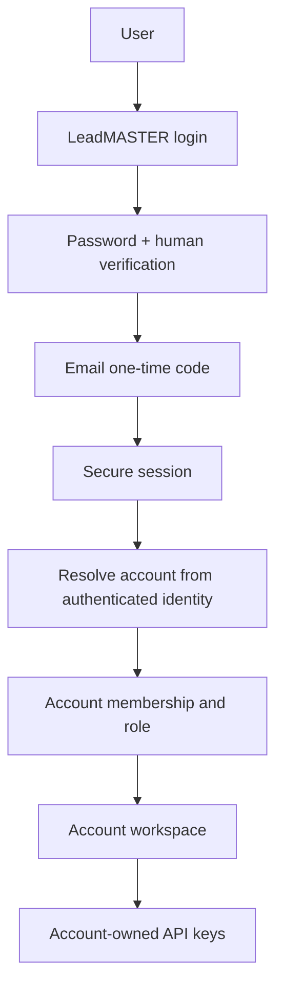
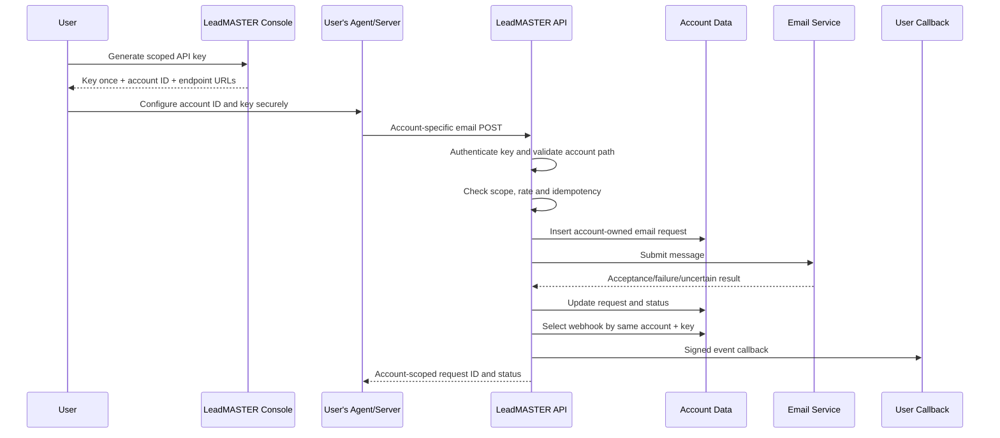
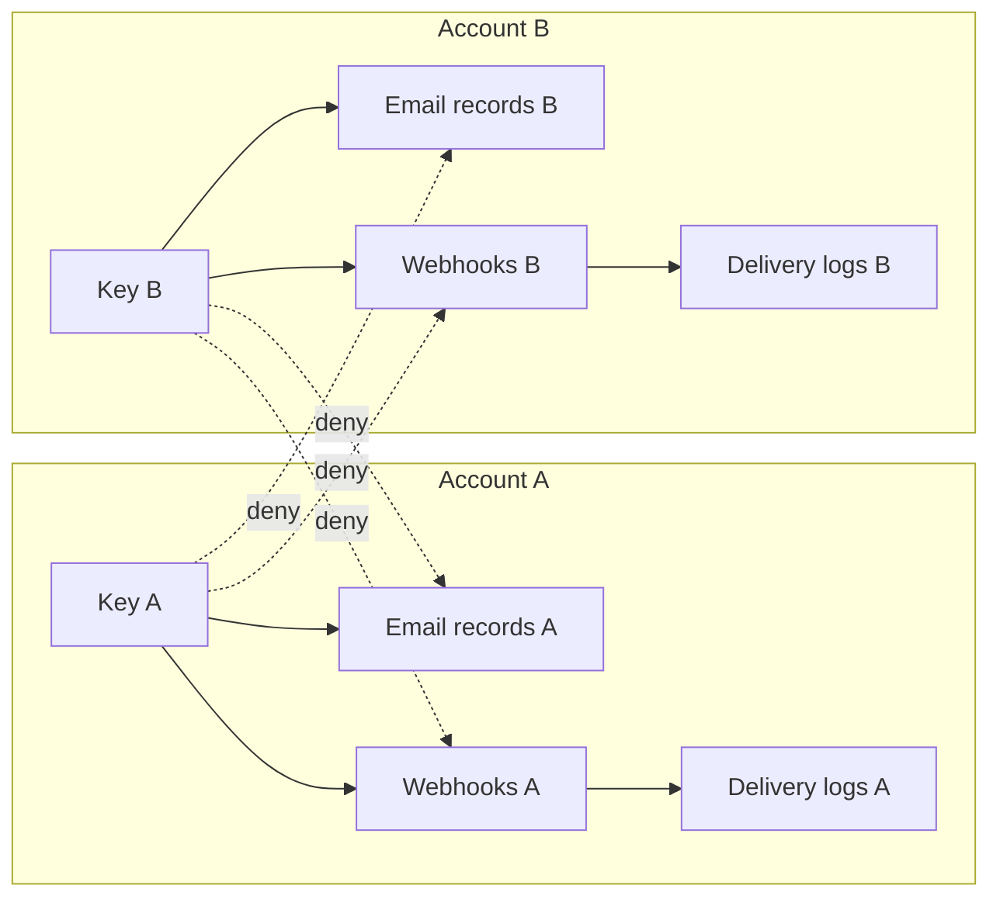

# LeadMASTER — Engineering and Agent Handover

**Repository:** `DevJel/LeadMASTER`  
**Working branch:** `feature/account-scoped-integrations`  
**Product:** LeadMASTER  
**Production URL:** https://leadmaster.jelvan.pro  
**Public documentation:** https://leadmaster.jelvan.pro/#documentation  
**Agent guide:** https://leadmaster.jelvan.pro/llms.txt

> This document is the maintainer handover. Follow it before making changes. It is not permission to use operator credentials, internal provider consoles or another user's account.

## 1. Product purpose and truthful status

LeadMASTER is an email workspace and developer integration service. The landing page and integrated documentation are the public product entry point. Human sign-in, API-key management, account-scoped REST routes and webhook code exist. The dashboard remains a navigation shell; campaigns, audiences, persistent templates, domain management and analytics are not complete modules. The email API and webhook paths require controlled authenticated end-to-end acceptance testing before delivery guarantees can be claimed.

The current authentication rollout supports one configured administrator identity. Account-scoped data ownership is implemented in the account-isolation branch, but self-service registration, multiple independent users, team invitations, organization switching and delegated membership management are not implemented. Never describe those capabilities as live.

MCP is an experimental read-only prototype and is not mounted in production. No public MCP endpoint or production send tool exists.

## 2. Non-negotiable product identity and confidentiality

- All user-facing product UI, landing copy, dashboard text, status messages, API docs, agent responses and examples must refer to the service as **LeadMASTER**.
- Do not disclose internal hosting, database, deployment, email transport, SMTP, provider, account, worker, secret-store, infrastructure or operator details in the UI or customer-facing responses.
- Do not disclose internal provider status as if it were LeadMASTER product status. Report only observable LeadMASTER capability and request outcomes.
- Do not expose internal binding names, account IDs from other users, database identifiers, secret names, deployment IDs, operator account names, infrastructure diagrams or internal credentials in public UI.
- Internal engineering configuration may retain the details required to operate the application. Keep those details out of product UI and public machine-readable documentation.
- Legal privacy disclosures are an exception where applicable law requires naming a processor or data recipient. Never conceal legally required privacy information; obtain privacy review before changing such disclosures.
- If asked about an underlying platform, explain that LeadMASTER is the product interface and provide only approved product-level information.

## 3. User/account context — highest priority

Every user-facing operation must be grounded in the current user's own LeadMASTER account context.

1. Confirm which LeadMASTER account the user selected or authenticated.
2. Read current account information from that account's authenticated workspace, saved account context or account-specific API response.
3. Use only that account's current account ID, API endpoint, API keys, webhook endpoints, signing secrets, integration configuration and saved information.
4. Never use internal operator access, shared platform credentials, developer test credentials, another user's account, or a guessed account ID.
5. Never enumerate account IDs or query another account to "discover" a user's data.
6. An account ID is a locator, not proof of authorization. The server must validate the Bearer key, scope, account match and resource ownership for every protected request.
7. If the user's account context is missing or ambiguous, stop and ask the user to select or connect the correct LeadMASTER account. Do not fall back to internal credentials.
8. All created resources must store explicit ownership: account ID plus creating API key or member identity. This applies to email requests, webhooks, webhook secrets, delivery records, API keys and any future MCP resource.
9. A resource lookup must include the account owner in its database predicate. Never fetch globally and filter in the browser.
10. Cross-account requests should return a non-disclosing not-found or unauthorized response; do not reveal whether another account's resource exists.

### Current rollout boundary

The account migration creates an opaque account ID for the authenticated identity and backfills existing developer resources using their recorded key owner. The current login system still accepts one configured administrator identity. Do not imply that every public visitor can create a separate account until registration and account lifecycle are implemented.

## 4. Account-specific API contract

The account root is:

`/api/v1/accounts/{account_id}`

The exact account ID is returned by the signed-in account console and API-key creation response. The account metadata route requires a key from the same account:

- `GET /api/v1/accounts/{account_id}`

Email:
- `POST /api/v1/accounts/{account_id}/emails` — `email:send`
- `GET /api/v1/accounts/{account_id}/emails/{request_id}` — `email:read`

Webhooks:
- `POST /api/v1/accounts/{account_id}/webhooks` — `webhook:manage`
- `GET /api/v1/accounts/{account_id}/webhooks` — `webhook:manage`
- `DELETE /api/v1/accounts/{account_id}/webhooks/{webhook_id}` — `webhook:manage`
- `GET /api/v1/accounts/{account_id}/webhooks/{webhook_id}/deliveries` — `webhook:manage`

Legacy unscoped `/api/v1/emails` and `/api/v1/webhooks` routes must fail closed. Do not silently route them to a shared account.

### API key rules

- API keys are random, hashed at rest and displayed once.
- Every key has one account owner and a minimum set of scopes.
- Create separate keys per integration and environment.
- List and revoke keys only inside the current authenticated account.
- Key creation response must include that account's `account_id`, `api_base_url`, `email_endpoint` and `webhook_endpoint`.
- Never expose a key in browser bundles, public docs, logs, chat or source control.
- A valid key from account A must not access account B, even if the caller supplies account B's URL.

### Email request ownership

Every email request must store `account_id` and `api_key_id`. Idempotency is unique per API key. Status lookup must require both account and creating key. The send operation must never use a caller-supplied sender identity or hidden platform-wide account context.

### Webhook ownership

Every webhook stores `account_id` and `api_key_id`. Delivery dispatch must filter by both. Delivery history must join through an owned webhook and enforce the same account and key. Webhook signing secrets are one-time reveal; protect them server-side. Never dispatch one account's event to another account's callback.

## 5. Human login vs AI agent access

Human administrator login uses password, human security verification and email OTP. It is not an agent integration.

AI agents:
- Must not open, automate, scrape, solve, bypass or replay the human security challenge.
- Must not request a user's password, OTP, browser cookie, challenge token or site key.
- Must not access login configuration endpoints to obtain security challenge details.
- Must use a server-side account-bound LeadMASTER API key with least-privilege scopes.
- Must not treat a browser session as an agent credential.

There is no agent bypass or challenge-free route for human login. The REST API is the supported server-to-server integration.

## 6. MCP policy

Current status: not mounted in production; no public endpoint; prototype is read-only and cannot send email.

Before MCP can be released:
- Each MCP client must authenticate a specific LeadMASTER account.
- Account context must be derived from the authenticated principal, never trusted from caller-supplied arguments.
- Each tool must enforce account membership, resource ownership and per-account scopes on the server.
- MCP must call the same account-scoped service functions as REST; no direct database, provider or operator access.
- Use per-account credentials, revocation, rate limits, audit events and abuse controls.
- Do not reuse human session cookies or API keys as an MCP protocol token without a separately reviewed credential exchange.
- Prevent cross-account enumeration, IDOR, prompt injection, tool-argument account substitution and data exfiltration.
- Add negative tests for account A attempting to read, mutate, revoke or receive events belonging to account B.
- Only then publish an MCP URL and update the landing page, README, API docs and `llms.txt`.

Until then, keep `/mcp` unavailable and direct integrations to the account-scoped REST API.

## 7. Architecture and data flow

### Human and account flow

### Account-scoped email and webhook flow

### Isolation boundary

## 8. Change protocol — update every affected layer

For every code change, review and update all affected layers in the same branch:

| Layer | Required work |
|---|---|
| UI | Landing, login, dashboard, API key console, responsive states, accessibility and account context |
| API | Routes, methods, schemas, account IDs, scopes, idempotency, errors and rate limits |
| Backend | Service logic, D1 predicates, migrations, secret boundaries, webhook dispatch and recovery |
| Security | Authentication, authorization, account isolation, IDOR, prompt injection and log redaction |
| Tests | Unit, integration, negative, regression and cross-account tests |
| Public docs | Landing Documentation tab, route examples, feature status, agent guide and crawler rules |
| Technical docs | `docs/API.md`, `docs/MCP.md`, auth/queue/security references |
| README | Capability matrix, repository map, setup, flow and Mermaid diagrams |
| Agent handover | This file: architecture, account rules, risks, release checks and exact deployment status |
| Change log | `CHANGELOG.md`: date, changes, tests and deployment status |
| Assets | Rebuild `src/static-assets.mjs` from canonical `public/` files |

If a layer is unaffected, write down why. Never leave generated assets stale after changing a public file.

## 9. Engineering best practices

- Keep handlers small and separate route parsing, authentication, authorization, business logic and persistence.
- Use parameterized SQL only.
- Include `account_id` in every query predicate for tenant-owned resources.
- Never rely on opaque IDs alone for authorization.
- Validate content type, body size, schema, enum values, URL schemes and rate limits server-side.
- Use secure random tokens; hash API keys; encrypt webhook secrets; reveal secrets once.
- Use constant-time signature comparisons and verify webhooks against the exact raw request body.
- Treat all user-provided email content and callback URLs as untrusted input.
- Block callback SSRF; DNS rebinding and private-address resolution require explicit defenses before declaring URL validation complete.
- Use idempotency for side effects and document uncertain outcomes.
- Keep internal details and secrets out of errors, logs, public docs and UI.
- Keep product language vendor-neutral and refer to LeadMASTER.
- Preserve existing production behavior until migrations and compatibility tests pass.
- Do not enable experimental features by changing flags alone; complete threat modeling, authorization, tests and rollback first.

## 10. Repository map

- `worker.js` — route handling, authentication and account resolution.
- `src/developer-api.mjs` — account-bound API keys, email submission, status and account metadata.
- `src/developer-webhooks.mjs` — account-owned webhook lifecycle and dispatch.
- `src/turnstile.mjs` — human login security verification only.
- `public/index.html` — canonical landing page and integrated docs.
- `public/login.html` — human login UI.
- `public/dashboard.html` — authenticated dashboard shell.
- `public/developer-api-keys.html` — account developer console.
- `public/llms.txt` and root `llms.txt` — machine-readable agent rules.
- `public/robots.txt` — crawler preferences; not access control.
- `migrations/` — ordered schema migrations.
- `test/` — automated tests.
- `docs/API.md` and `docs/MCP.md` — detailed integration contracts.
- `README.md` — project and developer handover summary.
- `AGENTS.md` — mandatory instructions for AI agents.

## 11. Release gates

Before deployment:
1. Verify migration order and run migration against a staging database first.
2. Confirm all existing API keys and webhook records are backfilled to the correct owner account.
3. Confirm no records remain with null account ownership; quarantine or reject any orphan.
4. Test account A and account B keys against each other's account routes; all cross-account attempts must fail.
5. Test key revocation, insufficient scopes, malformed account IDs, missing account IDs and legacy unscoped paths.
6. Verify email idempotency and status lookups are key- and account-scoped.
7. Verify webhook create/list/revoke/delivery history and dispatch are account-scoped.
8. Verify webhook HMAC, timestamp, raw-body and duplicate-event handling.
9. Run the complete test suite.
10. Rebuild static assets and check the generated bundle.
11. Deploy and smoke-test public pages, account API, security boundaries and MCP 404 behavior.
12. Perform controlled authenticated email and webhook callback acceptance tests.
13. Capture genuine landing, login, authenticated dashboard and dashboard-tab screenshots. Do not fabricate them or claim a protected view was captured without an authorized session.
14. Update README, this handover, `llms.txt`, landing docs and changelog with exact deployed state.

## 12. Screenshot evidence

Store genuine screenshots under `docs/screenshots/` with descriptive filenames:
- `landing.png`
- `login.png`
- `dashboard-overview.png`
- `dashboard-emails.png`
- `dashboard-logs.png`
- `dashboard-broadcasts.png`
- `dashboard-audiences.png`
- `dashboard-templates.png`
- `dashboard-domains.png`
- `dashboard-api-keys.png`
- `dashboard-webhooks.png`
- `dashboard-settings.png`

Screenshots must be captured from the actual rendered UI at a documented viewport. Use a dedicated test account and synthetic data for authenticated pages. Redact email addresses, account IDs, API keys, webhook secrets, OTPs and recipient content. The current dashboard tabs are placeholders; label screenshots accordingly and do not present them as completed features.

## 13. Current branch and deployment state

This handover accompanies `feature/account-scoped-integrations`. The account migration and account-scoped routes must be tested and applied before release. Do not claim these changes are already active in production until the migration, deployment and live account-isolation checks have succeeded.
