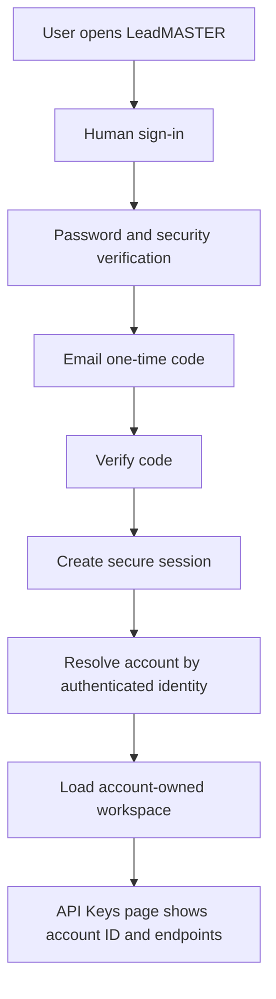
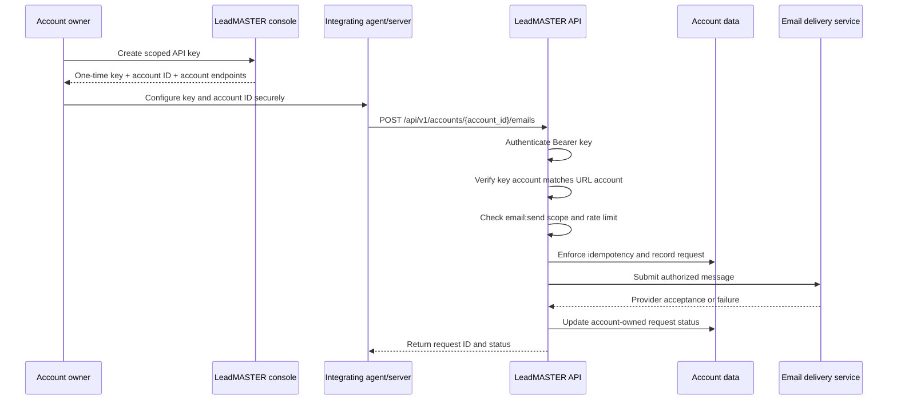
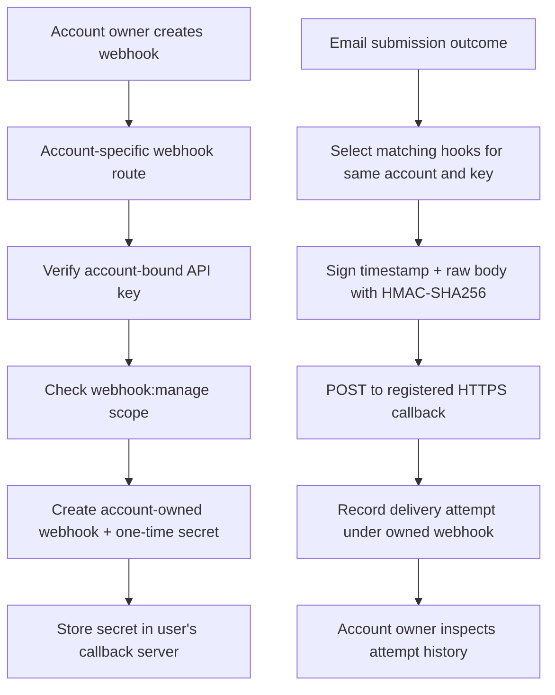
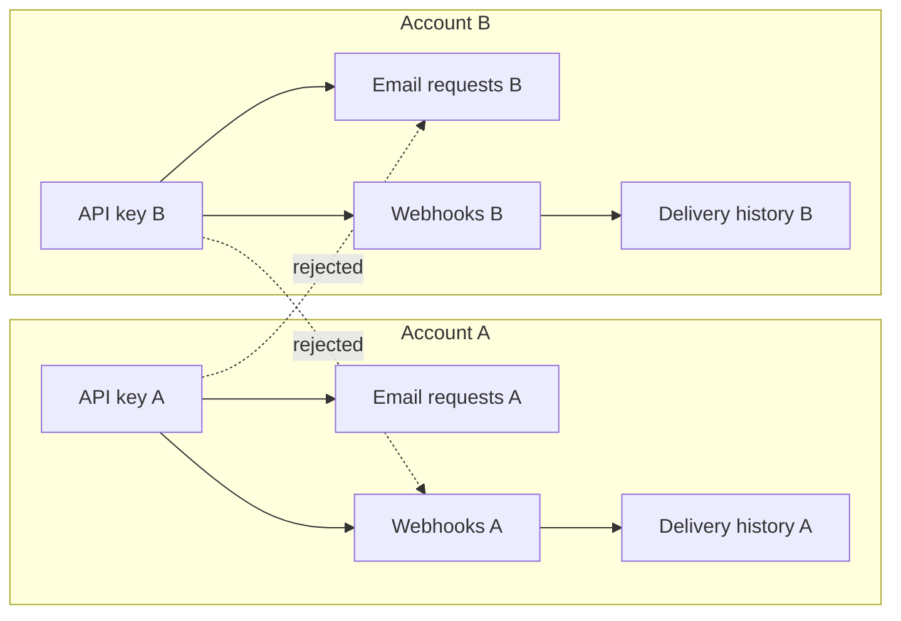

# LeadMASTER

LeadMASTER is an email workspace and developer integration service.

- **Production:** https://leadmaster.jelvan.pro
- **Public documentation:** https://leadmaster.jelvan.pro/#documentation
- **AI-agent instructions:** https://leadmaster.jelvan.pro/llms.txt
- **Crawler policy:** https://leadmaster.jelvan.pro/robots.txt
- **Detailed API reference:** [docs/API.md](docs/API.md)
- **Engineering handover:** [HANDOVER.md](HANDOVER.md)

## Product status

| Area | Current status | Boundary |
|---|---|---|
| Landing page and integrated documentation | Deployed | Main landing page is the public documentation hub |
| Human administrator authentication | Deployed | Password, human security verification and email OTP |
| Account identity and ownership model | Account-scoped schema and route enforcement implemented in this branch | Current sign-in rollout is one configured administrator identity; self-service registration, team invitations and organization switching are not available |
| Developer API keys | Deployed | Account-owned; shown once; scoped by permission |
| Account-specific email API | Implemented in this branch | Requires a key from the same account and its exact account ID |
| Account-specific webhooks | Implemented in this branch | Owned by the account and creating API key; one synchronous delivery attempt |
| Email delivery | Existing production route | Controlled authenticated end-to-end delivery verification remains outstanding |
| Dashboard | Navigation shell | Email activity, audiences, campaigns, templates, domains and analytics are not complete functional modules |
| HTML preview | Browser-local preview | Not a send or template-persistence feature |
| MCP | Experimental read-only prototype only | Not mounted in production; no public endpoint or send tool |

Do not describe planned dashboard sections as available. Do not equate an accepted email submission with inbox delivery.

## Account and integration model

Every account receives an opaque account ID. API keys, email requests, webhook registrations, webhook signing secrets and webhook delivery records are tied to that account. The account ID is an identifier, not a credential.

- Obtain the current user's account ID from the authenticated account console or the API-key creation response.
- Never guess, enumerate, copy from another user, or substitute an account ID.
- A key from account A cannot access account B's API requests, webhooks or delivery history.
- Every API operation requires the exact account-specific path and a key belonging to that account.
- Legacy unscoped integration paths are rejected.
- No platform-wide or shared API key is part of the public integration contract.

### Account provisioning and ownership

The account identity is initialized from the authenticated LeadMASTER identity. Existing API-key records are migrated to the account associated with their recorded owner. The current authentication rollout supports one configured administrator identity; self-service account registration, invitations, multi-member access and organization switching are not implemented. The membership schema is prepared for roles, but role-based team management must not be advertised as live.

## End-to-end flows

### Human sign-in and account context



### Account-scoped developer email API



### Account-owned webhook lifecycle



### Account isolation boundary



The account ID is not sufficient authorization by itself. The server validates the API key, scope, account ID, resource ownership and key ownership for every protected request.

## Account-specific API

All integration routes are rooted in the current account:

`/api/v1/accounts/{account_id}`

| Method | Account route | Scope | Purpose |
|---|---|---|---|
| GET | `/api/v1/accounts/{account_id}` | Valid account key | Read current account metadata and endpoint paths |
| POST | `/api/v1/accounts/{account_id}/emails` | `email:send` | Submit one email |
| GET | `/api/v1/accounts/{account_id}/emails/{id}` | `email:read` | Read request created by the same key |
| POST | `/api/v1/accounts/{account_id}/webhooks` | `webhook:manage` | Create an owned webhook |
| GET | `/api/v1/accounts/{account_id}/webhooks` | `webhook:manage` | List owned webhooks |
| DELETE | `/api/v1/accounts/{account_id}/webhooks/{id}` | `webhook:manage` | Revoke an owned webhook |
| GET | `/api/v1/accounts/{account_id}/webhooks/{id}/deliveries` | `webhook:manage` | Read latest 50 owned delivery attempts |

Legacy `/api/v1/emails` and `/api/v1/webhooks` routes are not supported.

### API-key scopes

- `email:send` — submit messages.
- `email:read` — read request status for the same key.
- `webhook:manage` — create, list, revoke webhooks and inspect their delivery attempts.

Use a distinct key per integration and environment. Grant only the required scopes. Keep keys server-side and rotate/revoke exposed credentials.

### Email request semantics

- JSON fields: `to`, `subject`, `text`, optional `html`.
- Exactly one recipient. No attachments, CC/BCC, multiple recipients, custom sender identity or bulk sending.
- Require a stable 16–128 character `Idempotency-Key`.
- Current per-key rate limit: 30 requests/minute.
- Maximum JSON body: 250,000 bytes.
- `accepted` means the downstream provider accepted the submission; it does not guarantee inbox placement or reading.
- `unknown` must be reconciled before retrying.

### Webhook semantics

Supported events: `email.accepted`, `email.failed`, `email.unknown`.

The webhook signing secret is shown once. Verify HMAC-SHA256 over `timestamp + "." + rawBody`, compare in constant time, reject stale timestamps and deduplicate by event ID. Current delivery is one synchronous attempt with a seven-second timeout. Automatic retries, replay, dead-letter recovery and delivery guarantees are not implemented.

## MCP status

The repository includes an experimental read-only MCP prototype. It is not mounted in production, has no public endpoint or client registration, and cannot send email. Do not publish or use a production MCP URL.

Any future MCP implementation must:
1. Authenticate a specific LeadMASTER account principal.
2. Derive account context from the authenticated principal, never from an untrusted tool argument.
3. Enforce the same account ownership and scope checks as REST.
4. Expose only resources owned by that account.
5. Use per-account credentials and revocation; never a platform-wide MCP token.
6. Never automate the human sign-in challenge or use a browser session as an agent credential.
7. Pass cross-account denial, prompt-injection, replay, rate-limit and data-leak tests before release.

## Security requirements

- Never request or expose passwords, OTPs, browser cookies, security challenge tokens, API keys or webhook secrets in chat.
- Never bypass human login security verification.
- Never access another user's account, integrations or saved data.
- Never disclose internal infrastructure or provider details in LeadMASTER UI or customer-facing responses. Refer to the product as LeadMASTER.
- Obtain explicit user approval before sending a message. Confirm recipient, purpose and content.
- Validate user authorization/consent and suppression in the integrating application.
- Redact authorization headers, signatures, recipients and message content from logs.
- Treat email and webhook payloads as sensitive personal data.
- Do not claim delivery, MCP availability, retries or dashboard functionality unless implemented and verified.

## Repository map

| Path | Purpose |
|---|---|
| `worker.js` | Application routing, human authentication and account resolution |
| `src/developer-api.mjs` | API-key console, account metadata, email API and request status |
| `src/developer-webhooks.mjs` | Account-owned webhook subscriptions, signing and delivery history |
| `src/turnstile.mjs` | Human sign-in security verification |
| `src/ses-smtp.mjs` | Email delivery transport adapter |
| `src/static-assets.mjs` | Generated production asset bundle; do not edit by hand |
| `public/` | Canonical landing, login, dashboard and developer UI assets |
| `migrations/` | Ordered database schema migrations |
| `test/` | Unit, regression, integration-boundary and account-isolation tests |
| `docs/API.md` | Detailed developer API reference |
| `docs/MCP.md` | MCP prototype and release requirements |
| `AGENTS.md` | Mandatory agent change protocol |
| `HANDOVER.md` | Engineering and production handover |
| `llms.txt` | Canonical machine-readable agent instructions |

## Local development

Requirements: Node.js 20+ and npm.

```bash
npm ci
npm test
npm run build:assets
```

Run the application locally using the configured Worker development command in the deployment environment. Do not commit local credentials or production secrets.

## Change protocol

Every change must review all impacted layers:

1. UI and responsive/accessibility behavior.
2. API routes, schemas, scopes, account ownership and error behavior.
3. Backend logic, persistence, migrations and secret boundaries.
4. Unit, regression, negative and cross-account security tests.
5. Landing-page Documentation tab and `llms.txt`.
6. `docs/API.md`, `docs/MCP.md` and relevant technical references.
7. README capability matrix and Mermaid flow diagrams.
8. `HANDOVER.md`, `AGENTS.md` and `CHANGELOG.md`.
9. Generated static assets and production route verification.

If a layer is unaffected, record why. Never update documentation to claim a feature before its backend and acceptance tests support it.

## Screenshot evidence

The CI workflow creates a `leadmaster-ui-screenshots` artifact containing landing, landing Documentation tab, login, dashboard section and account API-key console screenshots. These are watermarked local UI previews with synthetic data, not production evidence. See [docs/screenshots/README.md](docs/screenshots/README.md).

## Release and verification

Before production release:
- Apply migrations in order and verify the resulting schema.
- Run all tests, including account A/account B isolation and revoked-key cases.
- Verify legacy unscoped routes fail closed.
- Verify every account route rejects a key from another account.
- Verify webhook dispatch never crosses account boundaries.
- Run controlled authenticated email and callback tests with approved test endpoints.
- Check live landing, login, dashboard, API Keys and every dashboard navigation state.
- Capture genuine screenshots after the UI is loaded; do not fabricate screenshots or use placeholder account data as proof.
- Update the changelog and handover with exact deployment state.

## Current verification boundary

The account-scoping implementation in this branch is code and test work, not yet a production release. The production service must not be described as multi-user or account-isolated until the migration is applied, tests pass and the account routes are deployed and verified. Authenticated end-to-end delivery tests and logged-in dashboard screenshots still require a valid authorized session.
