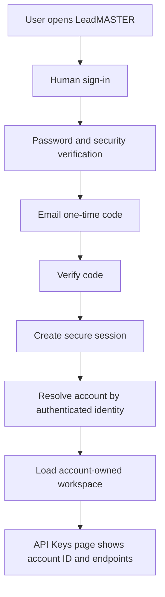
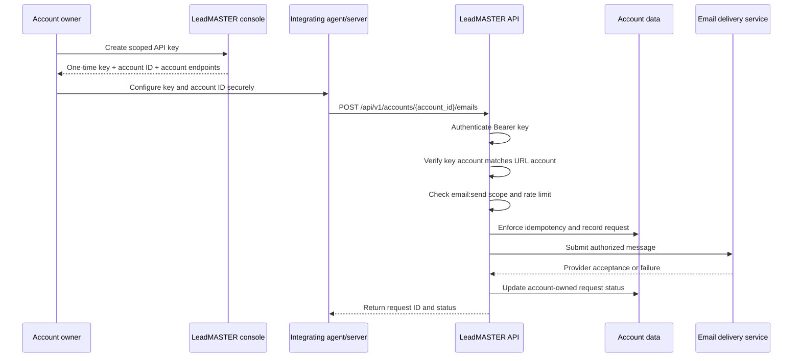
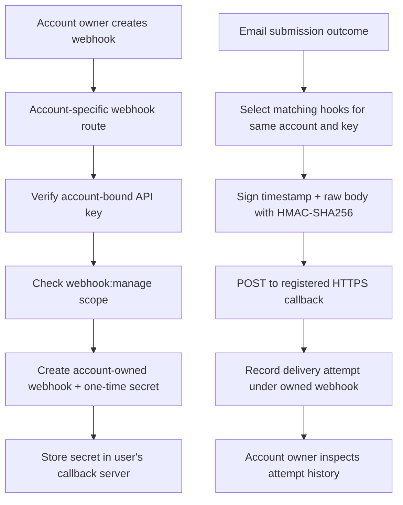
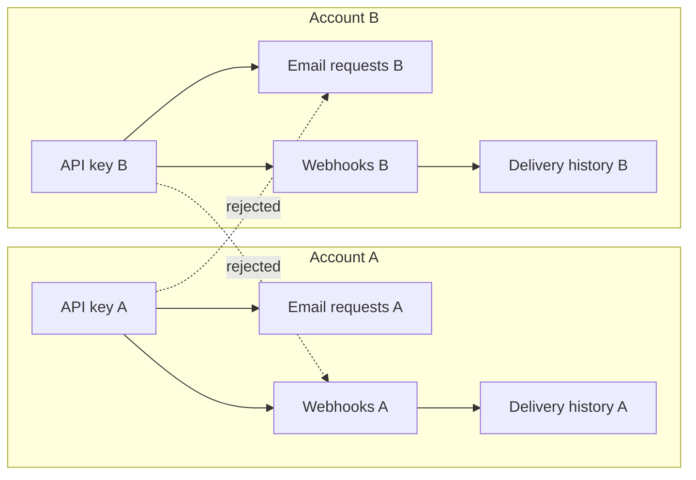

# LeadMASTER

LeadMASTER is an email workspace and developer integration service.

- **Production:** https://leadmaster.jelvan.pro
- **Public documentation:** https://leadmaster.jelvan.pro/#documentation
- **AI-agent instructions:** https://leadmaster.jelvan.pro/llms.txt
- **Crawler policy:** https://leadmaster.jelvan.pro/robots.txt
- **Detailed API reference:** [docs/API.md](docs/API.md)
- **Engineering handover:** [HANDOVER.md](HANDOVER.md)
- **Production mail workflow:** [docs/MAIL_WORKFLOW.md](docs/MAIL_WORKFLOW.md)

## Product status

| Area | Current status | Boundary |
|---|---|---|
| Landing page and integrated documentation | Deployed | Main landing page is the public documentation hub |
| Human administrator authentication | Deployed | Password, human security verification and email OTP |
| Account identity and ownership model | Account-scoped schema and route enforcement implemented in this branch | Current sign-in rollout is one configured administrator identity; self-service registration, team invitations and organization switching are not available |
| Developer API keys | Deployed | Account-owned; shown once; scoped by permission |
| Account-specific email API | Implemented in this branch | Requires a key from the same account and its exact account ID |
| Account-specific webhooks | Implemented in this branch | Owned by the account and creating API key; one synchronous delivery attempt |
| Email sending | Deployed through AWS SES SMTP and a dedicated sending queue | Dashboard bulk sends support up to 500 recipients per request; the queue releases no more than 10 messages per second |
| Dedicated inbox | Deployed for `inbound@inbound.leadmaster.jelvan.pro` | Only this new address is captured. Existing `jelvan.pro` and `operavaglobal.com` forwarding rules are unchanged |
| SES delivery updates | Deployed through a separate LeadMASTER configuration set and SNS event destination | Tracks sent, delivered, bounced, complaints, delays, rejects and sending failures; delivery is not the same as inbox placement |
| Dashboard | Deployed for the configured superadmin | Inbox, Sent, Archived, Bounced, Unsuccessful, Deleted, Unsubscribed, Activity, sender settings and notifications |
| AI reply suggestions | Deployed with Workers AI | Suggestions use related sent and received messages where available; a person reviews and sends the reply |
| Sound and device alerts | Deployed while the dashboard is open | Browser audio starts after user interaction; background push when the dashboard is closed is not configured |
| Email attachments | Original message is retained | Attachments remain inside the downloadable original email; separate attachment extraction is not yet available |
| HTML preview | Browser-local preview | Not a send or template-persistence feature |
| MCP | Experimental read-only prototype only | Not mounted in production; no public endpoint or send tool |

Do not describe planned dashboard sections as available. Do not equate an accepted email submission with inbox delivery.


## Production mail workspace

The superadmin dashboard uses a light, grayscale design and familiar labels. It includes:

- **Emails:** Inbox, Sent, Archived, Bounced, Unsuccessful, Deleted and Unsubscribed.
- **Activity:** a record of sign-ins, message actions, sending, delivery updates, profile changes and reply suggestions.
- **Notifications:** new incoming messages and AWS SES sending/delivery updates.
- **Reply suggestions:** a human-reviewed draft based on the current email and relevant sent/received history.
- **Sending addresses:** approved superadmin sender choices and the account holder's own name for regular API senders.

### Incoming mail

The dedicated inbox address is `inbound@inbound.leadmaster.jelvan.pro`. Its MX records and one exact-match Cloudflare Email Routing rule point to the `leadmaster-inbound-mail` email Worker. The Worker stores the original email in the dedicated R2 bucket and its searchable details in D1. The inbox notification and activity record are created when storage succeeds.

This is intentionally separate from all existing forwarding. Messages sent to other addresses at `jelvan.pro` or `operavaglobal.com` continue through their existing routes and are not copied into this new inbox.

### Outgoing mail and sending pace

Dashboard messages and account API messages enter the `leadmaster-mail-send` queue. One queue consumer processes a batch of up to 10 messages at a time, with a single active consumer and at least 100 ms between consecutive submissions. This caps the queue at no more than 10 messages per second. A separate failed-message queue records items that exhaust retries.

The dashboard accepts up to 500 unique recipient addresses in one bulk request. The account API remains one recipient per request and keeps its per-key request limit. Login verification codes and security alerts use the same LeadMASTER sender identity and AWS SES SMTP service directly so sign-in is not held behind bulk sending.

### Sender identity

- Login codes and security alerts: `LeadMASTER <noreply@leadmaster.jelvan.pro>`.
- Superadmin dashboard: `Jelvan Ricolcol <hello@work.jelvan.pro>`, `Operava <hello@operavaglobal.com>`, or another address under a verified LeadMASTER sending domain.
- Regular account API messages: the account holder's full name as the display name, an address generated under `leadmaster.jelvan.pro`, and the account's registered email as Reply-To. API users can provide `sender_name` to set or update their account name.

Only verified sending identities are accepted. SMTP credentials remain in Cloudflare Secrets Store and are never returned to the browser.

### Delivery status meanings

- **Waiting to send:** stored in the sending list.
- **Sending:** currently being submitted.
- **Sent:** AWS SES accepted the message.
- **Delivered:** the recipient's mail service confirmed receipt.
- **Delayed:** delivery is taking longer than expected.
- **Could not deliver:** a bounce was received.
- **Marked as unwanted:** a complaint was received.
- **Not sent:** sending failed.
- **Needs checking:** the final result could not be confirmed.

A delivered event does not guarantee inbox placement, display or reading. Permanent bounces and complaints are added to the do-not-contact list and are skipped by later sends.

See [docs/MAIL_WORKFLOW.md](docs/MAIL_WORKFLOW.md) for the complete flow and deployment map.

## Account and integration model

Every account receives an opaque account ID. API keys, email requests, webhook registrations, webhook signing secrets and webhook delivery records are tied to that account. The account ID is an identifier, not a credential.

- Obtain the current user's account ID from the authenticated account console or the API-key creation response.
- Never guess, enumerate, copy from another user, or substitute an account ID.
- A key from account A cannot access account B's API requests, webhooks or delivery history.
- Every API operation requires the exact account-specific path and a key belonging to that account.
- Legacy unscoped integration paths are rejected.
- No platform-wide or shared API key is part of the public integration contract.

### Account provisioning and ownership

The account identity is initialized from the authenticated LeadMASTER identity. Existing API-key records are migrated to the account associated with their recorded owner. The current authentication rollout supports one configured administrator identity; self-service account registration, invitations, multi-member access and organization switching are not implemented. The membership schema is prepared for roles, but role-based team management must not be advertised as live.

## End-to-end flows

### Human sign-in and account context



### Account-scoped developer email API



### Account-owned webhook lifecycle



### Account isolation boundary



The account ID is not sufficient authorization by itself. The server validates the API key, scope, account ID, resource ownership and key ownership for every protected request.

## Account-specific API

All integration routes are rooted in the current account:

`/api/v1/accounts/{account_id}`

| Method | Account route | Scope | Purpose |
|---|---|---|---|
| GET | `/api/v1/accounts/{account_id}` | Valid account key | Read current account metadata and endpoint paths |
| POST | `/api/v1/accounts/{account_id}/emails` | `email:send` | Submit one email |
| GET | `/api/v1/accounts/{account_id}/emails/{id}` | `email:read` | Read request created by the same key |
| POST | `/api/v1/accounts/{account_id}/webhooks` | `webhook:manage` | Create an owned webhook |
| GET | `/api/v1/accounts/{account_id}/webhooks` | `webhook:manage` | List owned webhooks |
| DELETE | `/api/v1/accounts/{account_id}/webhooks/{id}` | `webhook:manage` | Revoke an owned webhook |
| GET | `/api/v1/accounts/{account_id}/webhooks/{id}/deliveries` | `webhook:manage` | Read latest 50 owned delivery attempts |

Legacy `/api/v1/emails` and `/api/v1/webhooks` routes are not supported.

### API-key scopes

- `email:send` — submit messages.
- `email:read` — read request status for the same key.
- `webhook:manage` — create, list, revoke webhooks and inspect their delivery attempts.

Use a distinct key per integration and environment. Grant only the required scopes. Keep keys server-side and rotate/revoke exposed credentials.

### Email request semantics

- JSON fields: `to`, `subject`, `text`, optional `html`.
- Exactly one recipient. No attachments, CC/BCC, multiple recipients, custom sender identity or bulk sending.
- Require a stable 16–128 character `Idempotency-Key`.
- Current per-key rate limit: 30 requests/minute.
- Maximum JSON body: 250,000 bytes.
- `accepted` means the downstream provider accepted the submission; it does not guarantee inbox placement or reading.
- `unknown` must be reconciled before retrying.

### Webhook semantics

Supported events: `email.accepted`, `email.failed`, `email.unknown`.

The webhook signing secret is shown once. Verify HMAC-SHA256 over `timestamp + "." + rawBody`, compare in constant time, reject stale timestamps and deduplicate by event ID. Current delivery is one synchronous attempt with a seven-second timeout. Automatic retries, replay, dead-letter recovery and delivery guarantees are not implemented.

## MCP status

The repository includes an experimental read-only MCP prototype. It is not mounted in production, has no public endpoint or client registration, and cannot send email. Do not publish or use a production MCP URL.

Any future MCP implementation must:
1. Authenticate a specific LeadMASTER account principal.
2. Derive account context from the authenticated principal, never from an untrusted tool argument.
3. Enforce the same account ownership and scope checks as REST.
4. Expose only resources owned by that account.
5. Use per-account credentials and revocation; never a platform-wide MCP token.
6. Never automate the human sign-in challenge or use a browser session as an agent credential.
7. Pass cross-account denial, prompt-injection, replay, rate-limit and data-leak tests before release.

## Security requirements

- Never request or expose passwords, OTPs, browser cookies, security challenge tokens, API keys or webhook secrets in chat.
- Never bypass human login security verification.
- Never access another user's account, integrations or saved data.
- Never disclose internal infrastructure or provider details in LeadMASTER UI or customer-facing responses. Refer to the product as LeadMASTER.
- Obtain explicit user approval before sending a message. Confirm recipient, purpose and content.
- Validate user authorization/consent and suppression in the integrating application.
- Redact authorization headers, signatures, recipients and message content from logs.
- Treat email and webhook payloads as sensitive personal data.
- Do not claim delivery, MCP availability, retries or dashboard functionality unless implemented and verified.

## Repository map

| Path | Purpose |
|---|---|
| `worker.js` | Application routing, human authentication and account resolution |
| `src/developer-api.mjs` | API-key console, account metadata, email API and request status |
| `src/developer-webhooks.mjs` | Account-owned webhook subscriptions, signing and delivery history |
| `src/turnstile.mjs` | Human sign-in security verification |
| `src/ses-smtp.mjs` | Email delivery transport adapter |
| `src/static-assets.mjs` | Generated production asset bundle; do not edit by hand |
| `public/` | Canonical landing, login, dashboard and developer UI assets |
| `migrations/` | Ordered database schema migrations |
| `test/` | Unit, regression, integration-boundary and account-isolation tests |
| `docs/API.md` | Detailed developer API reference |
| `docs/MCP.md` | MCP prototype and release requirements |
| `AGENTS.md` | Mandatory agent change protocol |
| `HANDOVER.md` | Engineering and production handover |
| `llms.txt` | Canonical machine-readable agent instructions |

## Local development

Requirements: Node.js 20+ and npm.

```bash
npm ci
npm test
npm run build:assets
```

Run the application locally using the configured Worker development command in the deployment environment. Do not commit local credentials or production secrets.

## Change protocol

Every change must review all impacted layers:

1. UI and responsive/accessibility behavior.
2. API routes, schemas, scopes, account ownership and error behavior.
3. Backend logic, persistence, migrations and secret boundaries.
4. Unit, regression, negative and cross-account security tests.
5. Landing-page Documentation tab and `llms.txt`.
6. `docs/API.md`, `docs/MCP.md` and relevant technical references.
7. README capability matrix and Mermaid flow diagrams.
8. `HANDOVER.md`, `AGENTS.md` and `CHANGELOG.md`.
9. Generated static assets and production route verification.

If a layer is unaffected, record why. Never update documentation to claim a feature before its backend and acceptance tests support it.

## Screenshot evidence

The CI workflow creates a `leadmaster-ui-screenshots` artifact containing landing, landing Documentation tab, login, dashboard section and account API-key console screenshots. These are watermarked local UI previews with synthetic data, not production evidence. See [docs/screenshots/README.md](docs/screenshots/README.md).

## Release and verification

Before production release:
- Apply migrations in order and verify the resulting schema.
- Run all tests, including account A/account B isolation and revoked-key cases.
- Verify legacy unscoped routes fail closed.
- Verify every account route rejects a key from another account.
- Verify webhook dispatch never crosses account boundaries.
- Run controlled authenticated email and callback tests with approved test endpoints.
- Check live landing, login, dashboard, API Keys and every dashboard navigation state.
- Capture genuine screenshots after the UI is loaded; do not fabricate screenshots or use placeholder account data as proof.
- Update the changelog and handover with exact deployment state.

## Current verification boundary

The account-scoping migration has now been applied to the production D1 database, and the active production Worker already contains the account-specific API routes. The production schema and route code are therefore aligned. However, this does not make LeadMASTER a self-service multi-user service: human authentication still supports one configured administrator identity. Live authenticated account-isolation tests, controlled SES delivery, webhook callback acceptance and authenticated dashboard screenshots remain outstanding.

---

# Complete product and engineering documentation

This README is the repository-level product and engineering guide. The Worker source, migrations, tests and deployment configuration are authoritative if implementation differs from this document. Features are labelled by their actual state; planned or experimental work must not be described as production-ready.

## Product overview and features

LeadMASTER is an email workspace and developer email integration service. The current product surface includes:

- **Public landing page:** product introduction, responsive navigation, product status and integrated documentation.
- **Product showcase:** illustrative feature/workflow cards. They are concepts, not live campaign activity or delivery metrics.
- **Integrated documentation:** searchable overview, authentication, API, webhooks, operations, queue roadmap and agent/MCP guidance.
- **Human administrator sign-in:** password, Cloudflare Turnstile and email one-time passcode.
- **Dashboard:** authenticated account summary with the current account ID and API base URL, plus access to the developer console; not yet a complete mailbox or campaign workspace.
- **Developer API Keys console:** create named keys, assign scopes, view key metadata and revoke keys. The full key is shown once.
- **Account-specific email API:** submit one email, inspect eligible request status and manage account-owned webhooks.
- **Email templates:** branded OTP and new-login security-alert messages.
- **Browser-local HTML preview:** local rendering only; it does not send email or persist templates.
- **Legal pages:** draft Terms and Conditions and Data Privacy Notice; neither is effective or legally approved.

### Feature availability matrix

| Feature | Current state | Boundary |
|---|---|---|
| Landing page and responsive navigation | Implemented in source | Confirm production deployment separately |
| Integrated documentation and machine-readable llms.txt | Implemented | Must track actual release state |
| Administrator password + Turnstile + email OTP | Implemented in Worker source | One configured administrator identity |
| Opaque administrator sessions and logout revocation | Implemented | Eight-hour session expiry |
| API-key console and revocation | Implemented | Account-owned; raw key shown once |
| Account-scoped email API and status | Implemented in current branch | Controlled authenticated live acceptance tests remain outstanding |
| Signed account-owned webhooks | Implemented in current branch | One synchronous attempt; no automatic retries/replay |
| Dashboard mailbox, campaigns, audiences, templates and analytics | Planned/incomplete | Dashboard is currently a shell |
| Queue and Durable Object send coordinator | Experimental prototype | Not configured as the production send path |
| MCP | Experimental read-only prototype | Not mounted in production; no public endpoint or send tool |
| Self-service registration, invitations, team roles and organization switching | Not implemented | Do not advertise as available |
| Marketing consent, unsubscribe, suppression and campaign compliance tools | Not implemented | Do not use this API as a bulk marketing platform |

## Technology stack

| Layer | Technology | Purpose |
|---|---|---|
| Edge application runtime | Cloudflare Workers | Request routing, authentication, APIs and static delivery |
| Application language | JavaScript ES modules | Worker and browser application logic |
| Browser interface | HTML5, CSS and vanilla JavaScript | Landing, login, dashboard shell, API-key console and legal pages |
| Database | Cloudflare D1 | Authentication challenges, sessions, rate limits, accounts, API keys, email requests and webhooks |
| Secret management | Cloudflare Secrets Store | Admin credentials, cryptographic/session secret, Turnstile secret and SES SMTP credentials |
| Human anti-abuse | Cloudflare Turnstile | Login challenge and server-side Siteverify |
| Transactional email | Amazon SES SMTP over implicit TLS | OTP, security alerts and authorized email submissions |
| Cryptography | Web Crypto API | SHA-256, HMAC-SHA256, PBKDF2 verification and secure random tokens |
| Static asset pipeline | Generated src/static-assets.mjs from canonical public/ files | Worker-served browser assets |
| Development and tests | Node.js 20+, npm and Node test runner | Local development and automated tests |
| Agent integration research | MCP SDK dependency and prototype | Experimental only, not a production integration |

The current Wrangler configuration declares the leadmaster Worker, D1 binding AUTH_DB, Secrets Store bindings and observability. It does not configure a production Queue/Durable Object sending pipeline. Configuration values and secret names are not proof that a sender identity, quota or inbox delivery has been verified.

## High-level system architecture

The Worker is the application boundary. It validates requests and authorization before accessing account data or the email transport. Browser assets are authored under public/ and copied into the generated static module. Secret values are read at runtime from Secrets Store; they must never be copied into source files or browser bundles.

~~~mermaid
flowchart TB
  Browser[Browser: HTML, CSS, JavaScript] --> Worker[Cloudflare Worker: worker.js]
  Worker --> Router[Request routing and validation]
  Router --> Auth[Authentication and session checks]
  Router --> API[Developer API and webhook modules]
  Router --> Static[Generated static assets]
  Auth --> D1[(Cloudflare D1: AUTH_DB)]
  API --> D1
  Auth --> Secrets[Cloudflare Secrets Store]
  API --> Secrets
  Auth --> Turnstile[Cloudflare Turnstile Siteverify]
  Auth --> SES[Amazon SES SMTP over TLS]
  API --> SES
  Static --> Browser
~~~

### Main source components

| Component | Source path | Responsibility |
|---|---|---|
| Main Worker | worker.js | Routes, login, OTP, sessions, account resolution and API dispatch |
| HTTP router | src/http-router.mjs | Experimental queue-producer routing boundary |
| Developer API | src/developer-api.mjs | API keys, account metadata, email submission and status |
| Webhooks | src/developer-webhooks.mjs | Account-owned subscriptions, signatures and delivery history |
| SES transport | src/ses-smtp.mjs | SMTP transport over Cloudflare sockets |
| Turnstile adapter | src/turnstile.mjs | Server-side challenge verification |
| Email templates | src/email-templates.mjs | Generated OTP and security-alert template module |
| Static assets | src/static-assets.mjs | Generated production copy of public assets |
| Queue prototype | src/email-queue-core.mjs, src/email-queue-worker.mjs, src/queue-batch.mjs | Experimental queue coordination and batch handling |
| Queue producer | src/email-api.mjs | Disabled-by-default experimental bearer-key producer |
| MCP prototype | src/mcp-server.mjs | Experimental read-only MCP code; not mounted in production |
| Public interface | public/ | Canonical HTML, CSS, JavaScript, brand assets and email templates |
| Database schema | migrations/ | Ordered D1 migrations |
| Tests | test/ | Unit, regression and security-boundary tests |
| Deployment | wrangler.jsonc | Worker, D1, Secrets Store and observability configuration |

## Account and data ownership architecture

Each authenticated identity resolves to an opaque acct_ account ID. This identifier is a locator, not a credential. API keys, email requests, webhook registrations and delivery records are account-owned. Every protected request must validate the credential, scope, account ID and resource ownership.

The current administrator rollout is not a general multi-user SaaS identity system. Self-service registration, invitations, team administration and organization switching are not implemented. Schema preparation for membership or roles must not be advertised as a live team feature.

~~~mermaid
flowchart LR
  subgraph A[Account A]
    KA[API key A] --> EA[Email requests A]
    KA --> WA[Webhooks A]
    WA --> DA[Delivery history A]
  end
  subgraph B[Account B]
    KB[API key B] --> EB[Email requests B]
    KB --> WB[Webhooks B]
    WB --> DB[Delivery history B]
  end
  KA -. denied .-> EB
  KB -. denied .-> WA
~~~

## Authentication styles and flows

### Human administrator authentication

The implemented human login is sequential and server-validated:

1. Browser requests public login configuration and receives the Turnstile site key.
2. User completes the Cloudflare Turnstile widget configured for the login action.
3. Browser submits administrator identity, password and challenge token to the same-origin Worker endpoint.
4. Worker checks request origin, IP/email rate limits, Turnstile Siteverify, expected hostname/action, configured administrator allowlist and password.
5. Successful password verification creates a six-digit email OTP. Only an HMAC hash is stored in D1; the OTP expires after ten minutes and allows at most five verification attempts.
6. Valid OTP is consumed once. Worker creates a random 32-byte opaque session token and stores only its SHA-256 hash.
7. Browser receives an eight-hour Secure, HttpOnly, SameSite=Strict cookie.
8. Session checks are server-side. Logout revokes the stored session and expires the cookie. A new-login security email is best-effort.

~~~mermaid
flowchart TD
  A[Open administrator login] --> B[Load public Turnstile site key]
  B --> C[Complete login challenge]
  C --> D[POST identity, password and token]
  D --> E{Origin and rate limits valid?}
  E -- No --> X[Reject]
  E -- Yes --> F{Turnstile Siteverify valid?}
  F -- No --> X
  F -- Yes --> G{Admin allowlist and password valid?}
  G -- No --> X
  G -- Yes --> H[Generate six-digit OTP]
  H --> I[Store HMAC hash in D1 and send email]
  I --> J[Verify expiry and attempt count]
  J --> K{OTP valid and unused?}
  K -- No --> X
  K -- Yes --> L[Consume OTP and create opaque session]
  L --> M[Store SHA-256 session hash in D1]
  M --> N[Set secure session cookie]
  N --> O[Authenticated workspace]
  O --> P[Logout revokes session]
~~~

**Implemented authentication methods:** administrator password, Cloudflare Turnstile human verification and email OTP. PBKDF2-SHA256 password-hash format is supported; a legacy configured-secret comparison remains for migration compatibility and should be retired through a controlled credential migration.

**Not implemented:** passkeys/WebAuthn, Duo, social sign-in, SSO, public registration, self-service password reset, customer invitations and multi-admin role management. These must not be described as available.

### Machine-to-machine authentication

Developer integrations use a separate API-key model, not the human browser session. Keys are generated using secure randomness, shown once, stored as SHA-256 hashes with a short lookup prefix, assigned explicit scopes and bound to an account.

| Scope | Permission |
|---|---|
| email:send | Submit one email |
| email:read | Read request status for requests created by the same key |
| webhook:manage | Create/list/revoke owned webhooks and inspect their delivery attempts |

~~~mermaid
sequenceDiagram
  participant Owner as Authorized administrator
  participant UI as API Keys console
  participant App as Customer backend
  participant API as LeadMASTER API
  participant DB as D1
  Owner->>UI: Create named key and choose scopes
  UI->>DB: Store hash, prefix, account and scopes
  UI-->>Owner: Display raw key once
  Owner->>App: Store key in server-side secret manager
  App->>API: Bearer key and account-specific route
  API->>DB: Validate hash, revocation, scope and ownership
  DB-->>API: Authorization decision
  API-->>App: Authorized response or denial
~~~

## Security architecture and controls

Current source implements the following controls:

- Same-origin checks on human authentication and state-changing administrator operations.
- Server-side Turnstile Siteverify with expected hostname and action.
- IP/email login limits and OTP verification limits backed by D1.
- Administrator allowlist and configured password verification.
- Single-use, time-limited OTPs stored as HMAC hashes with a five-attempt cap.
- Cryptographically random opaque sessions; only token hashes are persisted.
- Secure, HttpOnly and SameSite=Strict session cookies.
- API-key hashing, prefix lookup, explicit scopes, revocation and account ownership checks.
- Account-scoped resource queries and rejection of legacy unscoped integration routes.
- Per-key API rate limiting and idempotency checks.
- Bounded JSON bodies, content-type checks and input validation.
- HMAC-SHA256 webhook signatures over timestamp plus raw body.
- HTTPS-only webhook destinations, redirects disabled and bounded callback timeout.
- Secrets Store bindings for sensitive runtime credentials.
- No secret values in repository documentation or browser assets.
- No-store and nosniff response headers on relevant API responses.
- HTML escaping for values inserted into email templates.

### Security responsibilities and limitations

- Turnstile site key is public; its Siteverify secret is private.
- Account ID alone does not authorize access.
- API keys and webhook signing secrets belong only in trusted server-side secret storage.
- Never disclose credentials, OTPs, cookies, message bodies or recipient lists in public chat or issue reports.
- Integrators must validate recipient authorization, consent, suppression and applicable legal basis before sending.
- Webhook consumers must verify signatures, enforce timestamp tolerance, deduplicate event IDs and reject unverified payloads.
- Webhook URL validation alone does not guarantee protection from DNS rebinding or private-network access; use callback hosts controlled by the account owner and review network safety.
- Provider acceptance, queue acceptance, SMTP acceptance and inbox delivery are distinct outcomes.
- The queue prototype has unresolved recovery, retention and dead-letter requirements.
- Mocked tests do not replace Cloudflare runtime, SES, browser acceptance or independent security testing.

~~~mermaid
flowchart TD
  R[Incoming request] --> TLS[HTTPS edge]
  TLS --> V[Validate method, body, schema]
  V --> I{Human session or API key?}
  I --> H[Human: origin, Turnstile, password, OTP]
  I --> M[API: bearer key, scope, account match]
  H --> L[Rate limits and session state]
  M --> L
  L --> D[Account-owned D1 records]
  D --> S[Read required runtime secret]
  S --> A[Authorized operation]
  A --> O[Persist status and evidence]
  V -->|Invalid| X[Fail closed]
  H -->|Invalid| X
  M -->|Invalid| X
  L -->|Limit exceeded| X
~~~

## Email API and webhook lifecycle

The exact REST contract and examples live in docs/API.md. Current constraints:

- One recipient per request; accepted fields are to, subject, text and optional html.
- Sender identity is configured by LeadMASTER and cannot be overridden by clients.
- No attachments, CC/BCC, multiple recipients, bulk sending or campaign scheduling.
- Stable 16–128 character Idempotency-Key is required.
- Current per-key limit is 30 requests per minute.
- Maximum JSON body is 250,000 bytes on the developer API route.
- accepted means the downstream provider accepted the submission, not inbox delivery or reading.
- unknown means outcome is uncertain; reconcile before a new send.
- Webhook events: email.accepted, email.failed and email.unknown.
- Webhook delivery currently makes one synchronous attempt with a seven-second timeout. Automatic retries, replay, dead-letter recovery and delivery guarantees are not implemented.

~~~mermaid
flowchart TD
  S[Authorized email request] --> V[Validate payload and idempotency]
  V --> A[Validate API key, scope and account]
  A --> D{Existing idempotency record?}
  D -- Yes --> R[Return existing request outcome]
  D -- No --> P[Persist request]
  P --> SES[Submit through SES SMTP]
  SES --> O{Known provider result?}
  O -->|Accepted| OK[Record accepted]
  O -->|Rejected| F[Record failed]
  O -->|Uncertain| U[Record unknown]
  OK --> E[Select matching account webhook]
  F --> E
  U --> E
  E --> H[HMAC-sign timestamp and raw payload]
  H --> C[One HTTPS callback attempt]
  C --> L[Record delivery attempt]
~~~

## Experimental queue design — not production enabled

Repository modules include a Cloudflare Queue consumer, Durable Object coordinator and enqueue helper. The intended design serializes outbound messages and coordinates a global send-rate ceiling. The authenticated producer, production bindings, durable outbox, reconciliation, monitoring, retention and operator recovery are incomplete. This is not the current production email submission path.

~~~mermaid
flowchart LR
  Producer[Future authenticated producer] -. disabled .-> Q[Cloudflare Queue]
  Q -. prototype consumer .-> DO[EmailCoordinator Durable Object]
  DO --> Rate[Rate and daily attempt counters]
  Rate --> SES[SES SMTP adapter]
  SES --> State[Coordinator state]
  Q -. future failure route .-> DLQ[Dead-letter queue]
  State -. recovery interface missing .-> Ops[Authorized reconciliation]
~~~

Do not enable EMAIL_API_ENABLED, attach production queues or claim a hard global SES quota guarantee until every gate in docs/QUEUE_DESIGN.md is implemented and tested. The coordinator cannot account for other applications sending through the same SES account and region.

## Legal, privacy and acceptable-use documentation

The public legal pages are published as the current LeadMASTER Data Privacy Notice and Terms and Conditions, effective 9 November 2026. They describe the deployed email workspace, administrator authentication, email processing, developer API, webhooks and AI-assisted reply suggestions. The pages identify the service operator and provide a privacy-request/contact channel.

The Data Privacy Notice describes categories of personal information, purposes and applicable lawful grounds, service providers, cross-border processing, security controls, retention principles, data-subject rights and contact/complaint routes. The Terms and Conditions describe authorized use, account security, sender and recipient responsibilities, prohibited conduct, API/webhook safeguards, content rights, service availability, suspension and applicable law.

Publication does not represent certification by a regulator or a substitute for periodic legal review. Operational owners must keep provider disclosures, data-flow descriptions, retention schedules, privacy-request handling, consent and suppression workflows aligned with actual production configuration and applicable law. Do not claim a fixed retention period or a control that has not been implemented.

~~~mermaid
flowchart TD
  A[Collect only necessary information] --> B[Use for disclosed service purposes]
  B --> C[Apply access and security controls]
  C --> D[Share with service providers only as needed]
  D --> E[Honor valid data-subject requests]
  E --> F[Retain only as long as lawfully necessary]
  F --> G[Securely delete or anonymize when eligible]
~~~

## Design system and accessibility

The current public interface uses a restrained editorial style: white and charcoal surfaces, dark text, muted gray secondary copy, fine borders, rounded controls and LeadMASTER brand assets under public/assets/brand/. The landing page includes responsive layouts, mobile navigation, keyboard-operable tabs, visible focus treatment and reduced-motion handling. Decorative halftone canvas content is hidden from assistive technology.

For UI changes:
- Preserve desktop and narrow mobile layouts.
- Do not introduce literal escaped text such as a backslash-n sequence into HTML output.
- Maintain readable contrast, semantic landmarks, labels, keyboard navigation and focus visibility.
- Respect prefers-reduced-motion.
- Keep generated assets synchronized with canonical public files.
- Never present illustrative mockups as evidence of live product capability.

## Local development, testing and release

Requirements: Node.js 20+ and npm.

~~~bash
npm ci
npm test
npm run build:assets
~~~

Before release, verify affected UI, API, persistence, migrations, security boundaries, documentation and generated assets. Include negative tests for invalid credentials, expired/reused OTPs, revoked API keys, missing scopes, wrong account IDs, duplicate idempotency keys, invalid webhook signatures and unauthorized resource access. Validate on the actual Cloudflare runtime and use an approved test recipient for SES acceptance checks.

A commit does not by itself mean a release is complete. Record separately:
- Source change and commit SHA.
- Test commands and observed results.
- Migration state.
- Worker deployment state.
- Live route and browser verification.
- SES provider acceptance versus inbox delivery.
- Remaining limitations and rollback plan.

## Documentation ownership

| Document | Source of truth for |
|---|---|
| README.md | Product overview, stack, architecture, security, authentication, legal status and release process |
| docs/API.md | Exact REST API and webhook contract |
| docs/PRODUCTION_AUTH.md | Authentication implementation and production bindings |
| docs/CLOUDFLARE_BINDINGS.md | Secret/binding mapping notes and deployment caveats |
| docs/QUEUE_DESIGN.md | Experimental queue design and release gates |
| docs/MCP.md | MCP prototype and security requirements |
| public/index.html | Public landing page and integrated documentation |
| public/llms.txt | Machine-readable product and agent guidance |
| public/terms.html | Published Terms and Conditions |
| public/privacy.html | Published Data Privacy Notice |
| HANDOVER.md | Operational handover and verified deployment state |
| CHANGELOG.md | Chronological source and release changes |

Update related references when implementation changes. Never make README, landing-page or agent-instruction claims that are ahead of code, tests or production verification.


## Production release update — 2026-11-09

- Production D1 migration `0004_account_scoped_integrations.sql` was applied successfully after verifying the existing developer tables and empty integration-record counts.
- Created/initialized Wrangler's `d1_migrations` tracking table and recorded migrations `0002`, `0003` and `0004` as applied, preventing a future remote migration run from replaying the account-column ALTER statements.
- Verified that the account, membership, API-key, email-request, webhook and webhook-delivery tables exist. Existing API-key, email-request and webhook record counts were zero at migration time, so no existing integration records required backfill.
- Production Worker version 144 is assigned 100% traffic. Its D1 and Secrets Store bindings match the repository's production configuration.
- The configured SES sender `hello@work.jelvan.pro` is an SES-verified identity with sending enabled. The sender was intentionally left unchanged; do not replace it without confirming the desired verified sender and updating configuration.
- This is a schema/configuration release, not proof of successful interactive login, Turnstile challenge, OTP receipt, outbound email inbox placement, webhook callback delivery or account-isolation acceptance tests.
