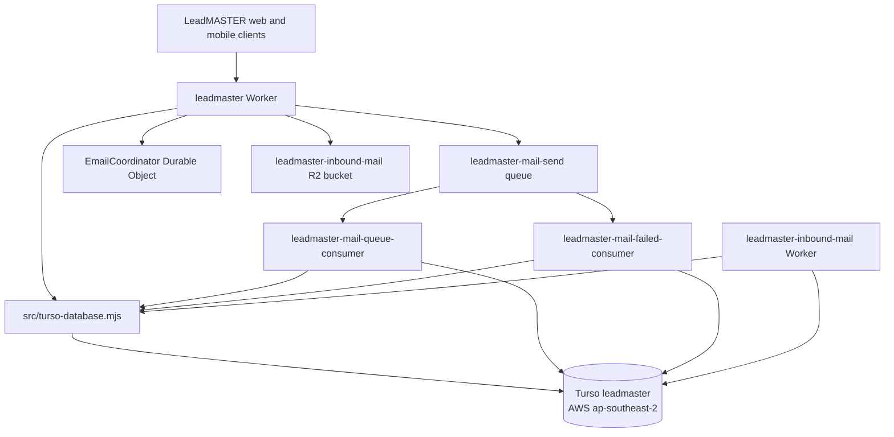

# LeadMASTER production database map

## Production decision

Turso is the sole production application database. The fresh-reset production database is in AWS ap-southeast-2 (Sydney):

- Database: `leadmaster`
- URL: `libsql://leadmaster-devjel.aws-ap-southeast-2.turso.io`
- Worker bindings: `TURSO_URL` and `TURSO_AUTH_TOKEN`
- Secret source: Cloudflare Secret Store `leadmaster-secrets` (store ID `e4c5eeca43e24f1fa21e6f808180e0dc`). The token value is never stored in source or this document.
- Runtime client: `@libsql/client/web`

No D1 data was imported. The active production Worker configurations have no D1 binding. Cloudflare's D1 database listing in the target account is empty, and lookup of the previous production D1 ID `246db481-9bff-4088-8dcc-b810138aea68` returns 404.

## Runtime mapping

| Production Worker | Database mapping | Other relevant bindings |
| --- | --- | --- |
| `leadmaster` | `TURSO_URL`, `TURSO_AUTH_TOKEN` | Secret Store auth/SES/Turnstile, EmailCoordinator, inbound R2, send queue |
| `leadmaster-mail-queue-consumer` | `TURSO_URL`, `TURSO_AUTH_TOKEN` | EmailCoordinator, SES settings |
| `leadmaster-mail-failed-consumer` | `TURSO_URL`, `TURSO_AUTH_TOKEN` | — |
| `leadmaster-inbound-mail` | `TURSO_URL`, `TURSO_AUTH_TOKEN` | inbound R2 |

The application's internal `AUTH_DB` name is a compatibility facade supplied by `withTursoDatabase(env)`. It is not a Cloudflare D1 binding.

## Schema and reset

The schema is provisioned by ordered SQL migrations `0001` through `0021`. The `leadmaster_schema_migrations` ledger records all 21 versions. The schema covers accounts and memberships, auth challenges/sessions/rate limits, lead records, inbound and sent mail, audience groups/contacts, templates/drafts, delivery events, SMTP connections, developer API keys/requests/webhooks, mail queues/claims/deduplication/notifications, reporter runs, and workspace activity.

The reset was intentionally clean: no D1 rows were copied. Core business tables were empty at validation; authentication challenge rows can appear as actual login flows run.

## Source-of-truth files

- `src/turso-database.mjs`: Turso client and D1-compatible query facade.
- `worker.js`: initializes the facade for fetch, scheduled, and email events.
- `workers/mail-queue-consumer.js`: initializes Turso before queue processing.
- `workers/mail-failed-consumer.js`: initializes Turso before failed-message processing.
- `migrations/0001_core_schema.sql` and `migrations/0002_*.sql`–`migrations/0021_*.sql`: schema history.
- `scripts/migrate-turso.mjs`: ordered migration runner.
- Production Wrangler files: `wrangler.jsonc`, `wrangler.mail-master-web-app.jsonc`, `wrangler.mail-master-web-app.queue-consumer.jsonc`, and `wrangler.mail-master-web-app.failed-consumer.jsonc`.

## Production validation recorded

- All four production Worker scripts have active deployments with 100% traffic on their latest deployment.
- All four deployed bundles include the Turso integration and contain no D1 database reference.
- All four production Worker binding lists use the same Turso URL and Secret Store token binding.
- Turso contains the expected application tables and the 21-version migration ledger.
- `PRAGMA foreign_key_check` returned no violations.
- The target Cloudflare account's D1 database listing is empty; lookup of the previous production D1 ID returns 404.

## Environment separation

Legacy/staging Wrangler configurations must not be pointed at this production database. Provision a separate staging Turso database and token before enabling staging so staging tests cannot write to production data.
