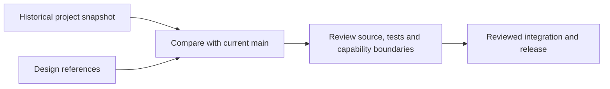

# LeadMASTER — implementation handoff

## Important status

This Folder is a **source and requirements handoff, not a completed or production-ready release**. It includes the existing repository and the unfinished implementation work. It does not contain a signed APK, deployment credentials, real SMTP credentials, or a guarantee that any staged feature is live. Do not deploy the supplied prototype or unmounted code directly.

Repository snapshot: `DevJel/LeadMASTER` `main` at commit `920fe0247eaa69cfc5fd137229cc86f40811216c` (PR #49 merged). The code was exported from Git as a snapshot, so Git history is not included. Before implementation, fetch the latest `main`, compare it with this snapshot, and work in one integration branch; do not blindly overwrite later changes. Merging staged code does not activate it. Earlier handoff documents describe historical states and may be stale; prioritize source and tests at the current revision.

## Handoff relationship

This folder is an archived handoff; its nested README files describe the captured revision, not current `main`. For the maintained product documentation and screenshots, start at the [root README](../README.md), [feature index](../docs/FEATURES.md), and [screenshot atlas](../docs/screenshots/README.md). Do not overwrite this historical snapshot when updating current documentation.



## What's inside

- `project/` — complete tracked source snapshot, including Worker, existing dashboard, Android shell, migrations, workflows, tests and staging documents.
- `design-references/App.tsx` and `index.css` — exact design files supplied by the owner. These are **design references, not production code**. The TSX contains sample records, unsupported `records.*` actions, locally simulated success, and unsafe/unfinished behaviors; replace these with real, secure functionality rather than deploying them.
- `design-references/inbox-loading-reference.html` and `sending-animation-reference.html` — owner-supplied animation references. Reimplement or integrate as React/TypeScript/CSS; do not adopt their timed, simulated outcome messages as real status. The owner requested TSX for the application, not a new HTML-coded dashboard.
- `design-references/illustrations/` — previously generated gray/white WebP empty-state artwork, to integrate where appropriate. No claim of live use.
- `REFERENCE-SHA256.txt` — checksums of the supplied design/reference files.

Read `project/AGENTS.md`, `project/HANDOVER.md`, and `project/README.md`, then `project/design-reference/2026-11-16-dashboard/INTEGRATION.md`, `project/docs/DASHBOARD_CONTROL_AUDIT.md`, and the `project/docs/*STAGING.md` files. The original stored prototype may also be recovered with `node design-reference/2026-11-16-dashboard/unpack.mjs` from `project/`.

## Owner's target — one complete integration

1. **Dashboard:** Implement the supplied `App.tsx` layout, components and interactions as a real React/TypeScript dashboard; use the existing LeadMASTER logo in `project/public/assets/brand/leadmaster-full.svg`. Keep the requested fixed light gray/white theme; replace black accents with appropriate grays and preserve legibility and accessibility. Make it responsive on desktop and Android-sized screens. Use the WebP artwork for suitable genuine empty states. Retain existing features and expose other existing features in Settings as requested. Do not remove or regress the existing backend, data, auth, routes, or workflows; backend additions must be backward-compatible and reviewed. No sample data, fake success, fabricated account identifiers or demo-only flows in production.
2. **Real integration:** Map the supplied views to existing same-origin, authenticated backend APIs. Keep mailbox, message detail, send/reply/forward, sender choices, templates, groups, suppressions, activity, notifications, developer features, and other existing controls. Preserve confirmations, idempotency, queue semantics, security and sanitized isolated HTML preview. Determine whether each prototype feature has a real backend; implement missing capabilities before advertising them, rather than simulating persistence or completion. The integration map in `project/design-reference/2026-11-16-dashboard/INTEGRATION.md` is a starting point, not proof of production behavior.
3. **Loading and sending:** Wire `src/dashboard-tsx/LoadingIndicator.tsx` to actual Inbox and relevant app request states. Wire `SendingIndicator.tsx` to actual send/queue events, using the person-to-building animation and light gray theme. Do not advance stages on timers, make up progress, retry ambiguous sends automatically, or label queued/SMTP-accepted mail as delivered. Provide truthful pending, errors, uncertain outcomes, empty states and reduced-motion support.
4. **External SMTP in Settings:** Capture Name, Email, Server, Username and Password, with appropriate port and TLS/STARTTLS settings. Add create, edit, remove and real bounded connection verification, with loading, error and success states. Never expose or prefill saved secrets. Only currently verified, account-owned sender configurations should appear alongside existing From choices. Implement end-to-end sending via the chosen sender and existing queue without breaking existing transports, suppression, concurrency, idempotency or uncertain-result handling. Changing or revoking credentials must not silently redirect already queued messages.
5. **LeadMASTER-only SMTP monitoring:** Show real, account- and sender-scoped LeadMASTER-created submissions and their queued, accepted, failed and unknown outcomes, with timestamps, pagination, refresh and honest loading/error/empty states. Do not show external provider-wide history or other applications' data. Accepted by SMTP is not delivered. Preserve privacy, retention and isolation.
6. **Sender-domain icons:** After the core integration is complete, safely obtain and validate domain-associated icons for inbound messages and replies, optimize them to appropriate small icon dimensions, and cache them for reuse across users where safe. Use trusted defaults for common consumer domains (e.g. Gmail/iCloud) or missing/untrusted icons. Do not treat a sender-supplied domain/logo as verified identity. Address SSRF, redirects, content validation, privacy/tracking, expiry, abuse and storage limits; never fetch untrusted addresses blindly.
7. **Android parity and release:** The existing Android app is a restricted WebView of the shared dashboard, not a separate email backend. Preserve trusted-origin navigation, authentication, cookies, Back, file chooser, downloads, external links, keyboard, system bars and accessibility. Update native code if needed, run the Android workflow, build a production-signed release with the owner's approved signing setup, and perform device acceptance. A debug APK is not a production release.

## Current staged code — not mounted

- `src/dashboard-tsx/Inbox.tsx`, `inbox-api.ts`, `inbox.css`: partial Inbox list, search and plain-text detail against existing endpoints; loader integrated in this component. Missing the full dashboard and mailbox workflows. See `docs/INBOX_TSX_STAGING.md`.
- `src/dashboard-tsx/LoadingIndicator.tsx`, `SendingIndicator.tsx` and associated CSS: reusable animations; sending animation is not connected to real composer/queue states. See `docs/DASHBOARD_LOADING_STAGING.md`.
- `src/dashboard-tsx/SmtpSettings.tsx` and `smtp-api.ts`: staged settings and monitoring UI; the route and panel are not mounted, and sending is not implemented. See `docs/SMTP_SETTINGS_UI_STAGING.md`.
- `src/external-smtp-*`, `migrations/0016*`–`0018*`: staged validation/encryption, connection store, activity ledger, probe, settings/verification, and sender-selection scaffolding. Consult the individual `docs/SMTP_*STAGING.md` files. These are not a complete SMTP transport or production deployment.
- `design-reference/2026-11-16-dashboard/dashboard-api.mjs` and `dashboard-model.mjs`: staging adapters/mappings; not the live dashboard.
- `migrations/0015_account_drafts.sql` and `src/email-drafts-api.mjs`: staged drafts service; route and integration require confirmation.

## Critical engineering and security gates

- **SMTP network boundary:** an injected socket factory is still missing. Before any arbitrary SMTP host is usable, enforce destination policy for private, loopback, link-local, metadata and restricted addresses, every DNS result, redirects/rebinding and connection-time resolution; preserve TLS certificate and original-hostname verification for implicit TLS and STARTTLS. Validate the actual Cloudflare runtime behavior. Do not disable TLS verification or assume hostname-only filtering solves SSRF. Provide timeouts, rate limits, audit-safe errors and a secure key lifecycle.
- **Isolation and race safety:** enforce account ownership server-side for connections, message records, credentials, monitoring and dispatch. Verify that queue records carry authoritative account context. Design and test an atomic credential-revision/send fence; a preliminary ownership check is not enough. Handle concurrent changes, revocation and ambiguous DATA outcomes safely. Do not log SMTP credentials or message contents.
- **Worker routing:** staged routes and TSX assets are not wired into the deployed application. A prior Worker routing edit was blocked by review. An authorized developer/reviewer must resolve the review and integrate the routes and authenticated asset serving safely; do not bypass review or expose unprotected assets. Do not assume that fixing the unrelated developer-email route completed this integration.
- **Data and migration safety:** review production schema, migration status, key provisioning and rollback. Do not automatically apply staged migrations to production. Preserve live data, existing behavior, authorization, CSRF defenses, sender selection and safe message rendering.
- **Testing:** unit and integration tests for authorization, cross-account access, SSRF/DNS/TLS, credentials, version races, queue outcomes, uncertain delivery, real SMTP probe and send against an authorized test server; browser tests for all UI paths and errors; desktop/mobile visual and accessibility checks, including reduced motion; Android builds and device acceptance. Tests using synthetic data do not prove production or real SMTP integration.
- **Release:** use a single reviewed integration branch/PR after the whole scope is ready, following the owner's request. Verify CI and test in an isolated staging environment. Deploy Cloudflare and Android only with an approved release plan, real configuration, smoke checks and rollback. Report actual deployed revision and APK signing/release status; do not claim delivery from queue acceptance.

## Run locally

Requirements: Node.js and npm as required by `project/package.json`, plus the Android SDK/JDK/Gradle requirements in `project/ANDROID APK/README.md` for Android. From `project/`:

```sh
npm ci
npm run check:dashboard
npm test
```

`npm run check:dashboard` validates/bundles staged components in memory; it does not build or mount the production TSX app. `npm run build:assets` rebuilds current static assets and may change generated files; use it only after understanding the existing build. Do not run migrations or send test mail against production. Configure real credentials only in an approved secret manager, never in source, ZIPs, logs or chat.

## Acceptance handoff

A release is complete only after the full design and existing functions are integrated, real SMTP and its monitoring work, sender icons are safely implemented, the Worker/deployment review is resolved, all tests and staging/device checks pass, production deployment is verified, and a signed Android release is built and validated. Clearly record any unsupported capability instead of reporting it as done.
